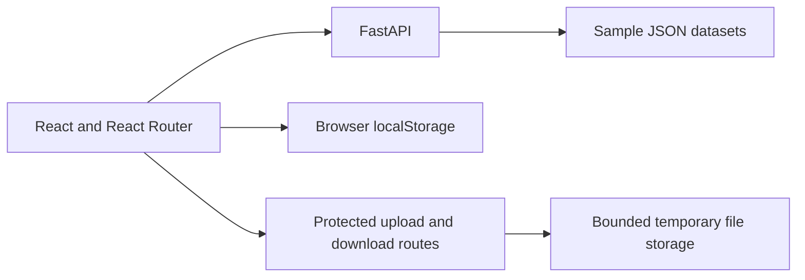

# The Daily Hacker · 더 데일리 해커

**Personal project · Full-stack web application · Hackathon discovery and team-building demo**

A newspaper-style interface for exploring hackathons, browsing teams, and reviewing project submissions and leaderboards.

**Stack:** React 18, Vite 6, React Router 7, Framer Motion, CSS, Python, FastAPI.

[Live demo](https://emergency-hackathon.vercel.app) · [한국어 소개](README.ko.md) · [Security and deployment](SECURITY.md)

## What it does

- Presents hackathon listings and details through a newspaper-inspired layout.
- Filters team listings by event and displays rankings and leaderboards.
- Tracks participation, locally created teams, offers, and pending submissions in the browser.
- Provides a FastAPI API for the sample event data.
- Accepts protected artifact uploads and serves protected downloads.

**Demo scope:** event data and rankings are sample data. Participation, team creation, and offers are local browser interactions; offers do not send messages to real people. The app does not provide production user accounts or cross-device synchronization.

## Architecture



## Engineering decisions

| Area | Implementation and purpose |
| --- | --- |
| UI | CSS columns, layered textures, and Framer Motion create the newspaper presentation. |
| Routing and data | A separate API service module connects event pages to FastAPI and local browser state. |
| Upload safety | Server-generated file IDs prevent client filenames from controlling storage paths or overwriting another upload. |
| Resource limits | A streamed request limit, 10 MiB file limit, and 100 MiB per-process storage quota bound uploads. |
| Download safety | Access checks, filename validation, symlink rejection, and attachment responses restrict file delivery. |
| Repository hygiene | Dependencies, virtual environments, caches, logs, and uploaded artifacts are excluded from Git. |

## Run locally

Use **Node.js 20.19+** and **Python 3.11**. Start from the repository root.

### 1. Backend

```bash
python3.11 -m venv .venv
source .venv/bin/activate
pip install -r daily-hacker/backend/requirements.txt
cd daily-hacker
export ALLOW_LOCAL_DEMO=true
uvicorn backend.main:app --host 127.0.0.1 --port 8000
```

The explicit local-demo exception is for loopback development only. On a public host, use a randomly generated `DEMO_ACCESS_TOKEN` of at least 32 characters and configure `ALLOWED_ORIGINS`. The browser asks for the demo access code before protected operations. See [the configuration example](daily-hacker/.env.example).

### 2. Frontend

In a second terminal, from the repository root:

```bash
cd daily-hacker
npm ci
npm run dev
```

Open [localhost:5173](http://localhost:5173). Locally, the frontend uses the API at `http://localhost:8000/api`. A deployed frontend uses same-origin `/api` by default; `VITE_API_URL` can point to another API host. Do not place credentials in `VITE_` variables.

## Verify

With the Python virtual environment active, from the repository root:

```bash
pip install -r requirements-test.txt
python -m pytest tests -q
```

The regression tests cover traversal filenames, duplicate upload names, authentication, file/storage limits, rejected extensions, symlink downloads, and oversized bodies.

From `daily-hacker/`, run `npm run build` to build the frontend.

## Deployment and limits

For Vercel, set the project **Root Directory to `daily-hacker`**. The Vite app builds to `dist`, while `api/index.py` exposes the FastAPI application. The deployment-level `requirements.txt` lists dependencies explicitly for the Python builder.

Uploads on Vercel use temporary storage. This demo's shared access code is not per-user file authorization, and its per-process quotas are not distributed limits. A multi-user service would need user authentication, private object storage, and persistent quotas before handling private files.

## Code map

- [daily-hacker/src/services/api.js](daily-hacker/src/services/api.js): API requests and local browser state.
- [daily-hacker/src/pages](daily-hacker/src/pages): event, team, and ranking pages.
- [daily-hacker/backend/main.py](daily-hacker/backend/main.py): sample-data and artifact routes.
- [daily-hacker/backend/security.py](daily-hacker/backend/security.py): access checks and body limits.
- [tests/test_security.py](tests/test_security.py): backend security regression tests.

See [SECURITY.md](SECURITY.md) for configuration and deployment details.
